<picture>
  <source media="(prefers-color-scheme: dark)" srcset="https://raw.githubusercontent.com/TyranoxHQ/.github/main/profile/assets/banner-dark.svg">
  <source media="(prefers-color-scheme: light)" srcset="https://raw.githubusercontent.com/TyranoxHQ/.github/main/profile/assets/banner-light.svg">
  
</picture>

 

  <a href="https://github.com/TyranoxHQ/.github/blob/main/profile/README.md">English</a> ·
  <a href="https://github.com/TyranoxHQ/.github/blob/main/profile/README.si.md">සිංහල</a> ·
  <strong>Español</strong> ·
  <a href="https://github.com/TyranoxHQ/.github/blob/main/profile/README.pt-BR.md">Português</a> ·
  <a href="https://github.com/TyranoxHQ/.github/blob/main/profile/README.de.md">Deutsch</a> ·
  <a href="https://github.com/TyranoxHQ/.github/blob/main/profile/README.ja.md">日本語</a> ·
  <a href="https://github.com/TyranoxHQ/.github/blob/main/profile/README.zh-CN.md">简体中文</a>

 

## <picture><source media="(prefers-color-scheme: dark)" srcset="https://raw.githubusercontent.com/TyranoxHQ/.github/main/profile/assets/icon-privacy-dark.svg"><source media="(prefers-color-scheme: light)" srcset="https://raw.githubusercontent.com/TyranoxHQ/.github/main/profile/assets/icon-privacy-light.svg"></picture> Quiénes somos

**Software ligero y rápido que mantiene tus datos en tus propios dispositivos.**

Tyranox crea herramientas locales (*local-first*) de uso diario para ordenador y móvil. Nuestras aplicaciones conectan tus dispositivos directamente entre sí, sin cuentas de usuario, sin servidores intermediarios en la nube y sin rastreo en segundo plano.

---

## <picture><source media="(prefers-color-scheme: dark)" srcset="https://raw.githubusercontent.com/TyranoxHQ/.github/main/profile/assets/icon-beside-dark.svg"><source media="(prefers-color-scheme: light)" srcset="https://raw.githubusercontent.com/TyranoxHQ/.github/main/profile/assets/icon-beside-light.svg"></picture> Nuestras aplicaciones

### [Beside](https://github.com/TyranoxHQ/beside)

**Intercambio directo de archivos, carpetas y texto entre Windows y Android a través de tu red Wi-Fi local.**

Diseñada para cualquier persona que quiera pasar fotos, documentos, carpetas o fragmentos de texto entre un PC con Windows y un teléfono Android sin enviarse correos a sí misma ni subir información a una nube de terceros.

- **Transferencias locales directas:** Los archivos viajan directamente entre tu PC con **Windows 10/11** y tu teléfono **Android 8.0+** dentro de tu propia red Wi-Fi.
- **Privacidad por defecto:** Protegida con cifrado **TLS 1.3 mutuo** y verificación entre dispositivos. Sin servidores en la nube, sin cuentas que crear y con cero rastreo.
- **Ligera y rápida:** Instaladores compactos y bajo consumo de memoria que no estorban en tu equipo.

**Descargar y obtener Beside:**
- **Versiones en GitHub (Windows y Android):** [Descargar la última versión](https://github.com/TyranoxHQ/beside/releases/latest)
- **Repositorio y documentación:** [github.com/TyranoxHQ/beside](https://github.com/TyranoxHQ/beside)
- **Obtener Beside Pro:** [Gumroad](https://thismalabs.gumroad.com/l/beside-pro) · [itch.io](https://thisma-labs.itch.io/beside)
- **Mirror de descarga:** [SourceForge](https://sourceforge.net/projects/beside-app/)

---

## <picture><source media="(prefers-color-scheme: dark)" srcset="https://raw.githubusercontent.com/TyranoxHQ/.github/main/profile/assets/icon-community-dark.svg"><source media="(prefers-color-scheme: light)" srcset="https://raw.githubusercontent.com/TyranoxHQ/.github/main/profile/assets/icon-community-light.svg"></picture> Participa

Desarrollamos nuestras herramientas escuchando directamente a nuestros usuarios y clientes:

- **Únete a la comunidad:** Haz preguntas, comparte comentarios y conversa sobre próximas funciones en [GitHub Discussions](https://github.com/TyranoxHQ/beside/discussions).
- **Informa de un error o solicita una función:** Abre un ticket en el [registro de incidencias de Beside](https://github.com/TyranoxHQ/beside/issues).
- **Informa de un problema de seguridad:** Comunica vulnerabilidades de forma privada mediante [GitHub Security Advisories](https://github.com/TyranoxHQ/beside/security/advisories/new) o consulta nuestra [Política de Seguridad](https://github.com/TyranoxHQ/.github/blob/main/SECURITY.md).

---

## Enlaces

- **Organización en GitHub:** [github.com/TyranoxHQ](https://github.com/TyranoxHQ)
- **Repositorio de Beside:** [github.com/TyranoxHQ/beside](https://github.com/TyranoxHQ/beside)
- **Tienda:** [Gumroad](https://thismalabs.gumroad.com/l/beside-pro) · [itch.io](https://thisma-labs.itch.io/beside)
- **Mirror:** [SourceForge](https://sourceforge.net/projects/beside-app/)

<!-- TODO: Add official website URL when live -->
<!-- TODO: Add support email when live -->
<!-- TODO: Add social links (X, LinkedIn, Discord, YouTube) when live -->
