<div align="center">

<picture>
  <source media="(prefers-color-scheme: dark)" srcset="https://raw.githubusercontent.com/TyranoxHQ/.github/main/profile/assets/banner-dark.svg">
  <source media="(prefers-color-scheme: light)" srcset="https://raw.githubusercontent.com/TyranoxHQ/.github/main/profile/assets/banner-light.svg">
  
</picture>

<br/>

<sub>
  <strong>English</strong> ·
  <a href="https://github.com/TyranoxHQ/.github/blob/main/profile/README.si.md">සිංහල</a> ·
  <a href="https://github.com/TyranoxHQ/.github/blob/main/profile/README.es.md">Español</a> ·
  <a href="https://github.com/TyranoxHQ/.github/blob/main/profile/README.pt-BR.md">Português</a> ·
  <a href="https://github.com/TyranoxHQ/.github/blob/main/profile/README.de.md">Deutsch</a> ·
  <a href="https://github.com/TyranoxHQ/.github/blob/main/profile/README.ja.md">日本語</a> ·
  <a href="https://github.com/TyranoxHQ/.github/blob/main/profile/README.zh-CN.md">简体中文</a>
</sub>

</div>

<br/>

## <picture><source media="(prefers-color-scheme: dark)" srcset="https://raw.githubusercontent.com/TyranoxHQ/.github/main/profile/assets/icon-privacy-dark.svg"><source media="(prefers-color-scheme: light)" srcset="https://raw.githubusercontent.com/TyranoxHQ/.github/main/profile/assets/icon-privacy-light.svg"></picture> Who we are

**Small, fast software that keeps your data on your own devices.**

```text
┌─[ tyranox@hq: ~ ]────────────────────────────────────┐
│                                                      │
│  $ whoami                                            │
│  Tyranox builds local-first tools for everyday       │
│  use across desktop and mobile.                      │
│                                                      │
│  $ cat principles.txt                                │
│  [direct]   devices connect to each other directly   │
│  [private]  no user accounts, no background tracking │
│  [local]    no cloud relay servers in between        │
│  [lean]     small installers, low memory usage       │
│                                                      │
│  $ _                                                 │
└──────────────────────────────────── local-first ─────┘
```

---

## <picture><source media="(prefers-color-scheme: dark)" srcset="https://raw.githubusercontent.com/TyranoxHQ/.github/main/profile/assets/icon-apps-dark.svg"><source media="(prefers-color-scheme: light)" srcset="https://raw.githubusercontent.com/TyranoxHQ/.github/main/profile/assets/icon-apps-light.svg"></picture> Our apps

<div align="center">

<a href="https://github.com/TyranoxHQ/closr"><picture>
  <source media="(prefers-color-scheme: dark)" srcset="https://raw.githubusercontent.com/TyranoxHQ/.github/main/profile/assets/closr-logo.png">
  <source media="(prefers-color-scheme: light)" srcset="https://raw.githubusercontent.com/TyranoxHQ/.github/main/profile/assets/closr-logo.png">
  
</picture></a>

<h3><a href="https://github.com/TyranoxHQ/closr">Closr</a> &nbsp;<sub><code>featured</code></sub></h3>

Local-first, ultra-fast peer-to-peer file, folder, and text sharing over Wi-Fi.

</div>

```text
┌─[ closr --info ]─────────────────────────────────────┐
│                                                      │
│  what       p2p file, folder & text sharing          │
│  network    local Wi-Fi, mDNS discovery              │
│  security   mutual TLS 1.3, 8-digit SAS pairing      │
│  privacy    zero cloud, zero accounts                │
│  windows    x64, Microsoft Store + direct installer  │
│  android    planned companion release                │
│  editions   Closr Free / Closr Pro                   │
│                                                      │
└───────────────────────────────────────── latest ─────┘
```

<p align="center">
  <a href="https://github.com/TyranoxHQ/closr"><b>Repository</b></a> &nbsp;·&nbsp;
  <a href="https://github.com/TyranoxHQ/closr/releases"><b>Releases</b></a> &nbsp;·&nbsp;
  <a href="https://github.com/TyranoxHQ/closr/issues"><b>Issues</b></a> &nbsp;·&nbsp;
  <a href="https://github.com/TyranoxHQ/closr/blob/main/SECURITY.md"><b>Security</b></a>
</p>

<br/>

<div align="center">

<a href="https://github.com/TyranoxHQ/beside"><picture>
  <source media="(prefers-color-scheme: dark)" srcset="https://raw.githubusercontent.com/TyranoxHQ/.github/main/profile/assets/icon-beside-dark.svg">
  <source media="(prefers-color-scheme: light)" srcset="https://raw.githubusercontent.com/TyranoxHQ/.github/main/profile/assets/icon-beside-light.svg">
  
</picture></a>

<h3><a href="https://github.com/TyranoxHQ/beside">Beside</a></h3>

Direct file, folder, and text sharing between Windows and Android over your local Wi-Fi.

</div>

Built for anyone who wants to move photos, documents, folders, or text snippets between a Windows PC and an Android phone without emailing files to themselves or uploading data to a third-party cloud.

```text
┌─[ beside --info ]────────────────────────────────────┐
│                                                      │
│  what       direct file, folder & text sharing       │
│  between    Windows 10/11  <->  Android 8.0+         │
│  network    your own local Wi-Fi                     │
│  security   mutual TLS 1.3 + device verification     │
│  privacy    no cloud, no accounts, zero tracking     │
│  footprint  lean installers, low memory usage        │
│  editions   Beside Free / Beside Pro                 │
│                                                      │
└──────────────────────────── windows <-> android ─────┘
```

**Download & get Beside:**
- **GitHub Releases (Windows & Android):** [Download latest release](https://github.com/TyranoxHQ/beside/releases/latest)
- **Repository & documentation:** [github.com/TyranoxHQ/beside](https://github.com/TyranoxHQ/beside)
- **Get Beside Pro:** [Gumroad](https://thismalabs.gumroad.com/l/beside-pro) · [itch.io](https://thisma-labs.itch.io/beside)
- **Download mirror:** [SourceForge](https://sourceforge.net/projects/beside-app/)
- **Platform support:** [beside-windows-support](https://github.com/TyranoxHQ/beside-windows-support) · [beside-android-support](https://github.com/TyranoxHQ/beside-android-support)

---

## <picture><source media="(prefers-color-scheme: dark)" srcset="https://raw.githubusercontent.com/TyranoxHQ/.github/main/profile/assets/icon-stack-dark.svg"><source media="(prefers-color-scheme: light)" srcset="https://raw.githubusercontent.com/TyranoxHQ/.github/main/profile/assets/icon-stack-light.svg"></picture> Stack

```text
┌─[ tyranox --stack ]──────────────────────────────────┐
│                                                      │
│  [platforms]                                         │
│    Windows 10/11 x64    Android 8.0+ arm64           │
│                                                      │
│  [transport]                                         │
│    mutual TLS 1.3    mDNS discovery    TCP_NODELAY   │
│                                                      │
│  [crypto]                                            │
│    rustls    ring    SPKI SHA-256 pinning    SAS     │
│                                                      │
│  [key storage]                                       │
│    Windows DPAPI    Android Keystore AES-256-GCM     │
│                                                      │
│  [distribution]                                      │
│    MSIX    GitHub Releases    SourceForge            │
│                                                      │
└──────────────────────────────────────────────────────┘
```

<sub>As documented in the <a href="https://github.com/TyranoxHQ/beside">Beside</a> and <a href="https://github.com/TyranoxHQ/closr">Closr</a> repositories.</sub>

---

## <picture><source media="(prefers-color-scheme: dark)" srcset="https://raw.githubusercontent.com/TyranoxHQ/.github/main/profile/assets/icon-community-dark.svg"><source media="(prefers-color-scheme: light)" srcset="https://raw.githubusercontent.com/TyranoxHQ/.github/main/profile/assets/icon-community-light.svg"></picture> Get involved

We build our tools with direct feedback from users and customers:

```text
┌─[ ~/community ]──────────────────────────────────────┐
│                                                      │
│  bugs / ideas   ->  public issue trackers            │
│  security       ->  report privately, not in issues  │
│  policy         ->  SECURITY.md                      │
│                                                      │
└──────────────────────────────────────────────────────┘
```

- **Report a bug or request a feature:** [Closr issues](https://github.com/TyranoxHQ/closr/issues) · [Beside issues](https://github.com/TyranoxHQ/beside/issues)
- **Report a security issue:** privately via [GitHub Security Advisories](https://github.com/TyranoxHQ/beside/security/advisories/new) (Beside), the [Closr security policy](https://github.com/TyranoxHQ/closr/blob/main/SECURITY.md), or review our [Security Policy](https://github.com/TyranoxHQ/.github/blob/main/SECURITY.md)

---

## Links

- **GitHub Organization:** [github.com/TyranoxHQ](https://github.com/TyranoxHQ)
- **Repositories:** [Closr](https://github.com/TyranoxHQ/closr) · [Beside](https://github.com/TyranoxHQ/beside)
- **Store:** [Gumroad](https://thismalabs.gumroad.com/l/beside-pro) · [itch.io](https://thisma-labs.itch.io/beside)
- **Mirror:** [SourceForge](https://sourceforge.net/projects/beside-app/)

```text
┌──────────────────────────────────────────────────────┐
│  $ logout                                            │
│  Tyranox . local-first software . Sri Lanka          │
└──────────────────────────────────────────────────────┘
```

<!-- TODO: Add official website URL when live -->
<!-- TODO: Add support email when live -->
<!-- TODO: Add social links (X, LinkedIn, Discord, YouTube) when live -->
