<picture>
  <source media="(prefers-color-scheme: dark)" srcset="https://raw.githubusercontent.com/TyranoxHQ/.github/main/profile/assets/banner-dark.svg">
  <source media="(prefers-color-scheme: light)" srcset="https://raw.githubusercontent.com/TyranoxHQ/.github/main/profile/assets/banner-light.svg">
  
</picture>

 

  <a href="https://github.com/TyranoxHQ/.github/blob/main/profile/README.md">English</a> ·
  <a href="https://github.com/TyranoxHQ/.github/blob/main/profile/README.si.md">සිංහල</a> ·
  <a href="https://github.com/TyranoxHQ/.github/blob/main/profile/README.es.md">Español</a> ·
  <strong>Português</strong> ·
  <a href="https://github.com/TyranoxHQ/.github/blob/main/profile/README.de.md">Deutsch</a> ·
  <a href="https://github.com/TyranoxHQ/.github/blob/main/profile/README.ja.md">日本語</a> ·
  <a href="https://github.com/TyranoxHQ/.github/blob/main/profile/README.zh-CN.md">简体中文</a>

 

## <picture><source media="(prefers-color-scheme: dark)" srcset="https://raw.githubusercontent.com/TyranoxHQ/.github/main/profile/assets/icon-privacy-dark.svg"><source media="(prefers-color-scheme: light)" srcset="https://raw.githubusercontent.com/TyranoxHQ/.github/main/profile/assets/icon-privacy-light.svg"></picture> Quem somos

**Software leve e rápido que mantém seus dados nos seus próprios dispositivos.**

A Tyranox desenvolve ferramentas *local-first* para o uso diário no computador e no celular. Nossos aplicativos conectam seus dispositivos diretamente entre si, sem contas de usuário, sem servidores intermediários na nuvem e sem rastreamento em segundo plano.

---

## <picture><source media="(prefers-color-scheme: dark)" srcset="https://raw.githubusercontent.com/TyranoxHQ/.github/main/profile/assets/icon-beside-dark.svg"><source media="(prefers-color-scheme: light)" srcset="https://raw.githubusercontent.com/TyranoxHQ/.github/main/profile/assets/icon-beside-light.svg"></picture> Nossos aplicativos

### [Beside](https://github.com/TyranoxHQ/beside)

**Compartilhamento direto de arquivos, pastas e textos entre Windows e Android pela sua rede Wi-Fi local.**

Criado para quem precisa transferir fotos, documentos, pastas ou trechos de texto entre um PC com Windows e um celular Android sem precisar enviar e-mails para si mesmo ou fazer upload de arquivos para nuvens de terceiros.

- **Transferências locais diretas:** Os arquivos são enviados diretamente entre o seu PC **Windows 10/11** e o seu celular **Android 8.0+** através da sua própria rede Wi-Fi.
- **Privacidade por padrão:** Protegido com criptografia **TLS 1.3 mútua** e verificação entre dispositivos. Sem servidores na nuvem, sem necessidade de criar conta e com zero rastreamento.
- **Leve e rápido:** Instaladores enxutos e baixo uso de memória que não atrapalham o desempenho do seu sistema.

**Baixar e obter o Beside:**
- **GitHub Releases (Windows e Android):** [Baixar a versão mais recente](https://github.com/TyranoxHQ/beside/releases/latest)
- **Repositório e documentação:** [github.com/TyranoxHQ/beside](https://github.com/TyranoxHQ/beside)
- **Obter o Beside Pro:** [Gumroad](https://thismalabs.gumroad.com/l/beside-pro) · [itch.io](https://thisma-labs.itch.io/beside)
- **Mirror de download:** [SourceForge](https://sourceforge.net/projects/beside-app/)

---

## <picture><source media="(prefers-color-scheme: dark)" srcset="https://raw.githubusercontent.com/TyranoxHQ/.github/main/profile/assets/icon-community-dark.svg"><source media="(prefers-color-scheme: light)" srcset="https://raw.githubusercontent.com/TyranoxHQ/.github/main/profile/assets/icon-community-light.svg"></picture> Participe

Construímos nossas ferramentas com o feedback direto de usuários e clientes:

- **Participe da comunidade:** Tire dúvidas, compartilhe sugestões e converse sobre novos recursos no [GitHub Discussions](https://github.com/TyranoxHQ/beside/discussions).
- **Relate um problema ou peça um recurso:** Abra um chamado no [Issue Tracker do Beside](https://github.com/TyranoxHQ/beside/issues).
- **Relate uma falha de segurança:** Comunique vulnerabilidades de forma privada pelo [GitHub Security Advisories](https://github.com/TyranoxHQ/beside/security/advisories/new) ou consulte nossa [Política de Segurança](https://github.com/TyranoxHQ/.github/blob/main/SECURITY.md).

---

## Links

- **Organização no GitHub:** [github.com/TyranoxHQ](https://github.com/TyranoxHQ)
- **Repositório do Beside:** [github.com/TyranoxHQ/beside](https://github.com/TyranoxHQ/beside)
- **Loja:** [Gumroad](https://thismalabs.gumroad.com/l/beside-pro) · [itch.io](https://thisma-labs.itch.io/beside)
- **Mirror:** [SourceForge](https://sourceforge.net/projects/beside-app/)

<!-- TODO: Add official website URL when live -->
<!-- TODO: Add support email when live -->
<!-- TODO: Add social links (X, LinkedIn, Discord, YouTube) when live -->
