<picture>
  <source media="(prefers-color-scheme: dark)" srcset="https://raw.githubusercontent.com/TyranoxHQ/.github/main/profile/assets/banner-dark.svg">
  <source media="(prefers-color-scheme: light)" srcset="https://raw.githubusercontent.com/TyranoxHQ/.github/main/profile/assets/banner-light.svg">
  
</picture>

 

  <a href="https://github.com/TyranoxHQ/.github/blob/main/profile/README.md">English</a> ·
  <strong>සිංහල</strong> ·
  <a href="https://github.com/TyranoxHQ/.github/blob/main/profile/README.es.md">Español</a> ·
  <a href="https://github.com/TyranoxHQ/.github/blob/main/profile/README.pt-BR.md">Português</a> ·
  <a href="https://github.com/TyranoxHQ/.github/blob/main/profile/README.de.md">Deutsch</a> ·
  <a href="https://github.com/TyranoxHQ/.github/blob/main/profile/README.ja.md">日本語</a> ·
  <a href="https://github.com/TyranoxHQ/.github/blob/main/profile/README.zh-CN.md">简体中文</a>

 

## <picture><source media="(prefers-color-scheme: dark)" srcset="https://raw.githubusercontent.com/TyranoxHQ/.github/main/profile/assets/icon-privacy-dark.svg"><source media="(prefers-color-scheme: light)" srcset="https://raw.githubusercontent.com/TyranoxHQ/.github/main/profile/assets/icon-privacy-light.svg"></picture> අප ගැන

**ඔබේ දත්ත ඔබේම උපාංග තුළ සුරක්ෂිතව තබාගන්නා සැහැල්ලු සහ වේගවත් මෘදුකාංග.**

Tyranox මඟින් පරිගණක සහ ජංගම දුරකථන සඳහා එදිනෙදා ප්‍රයෝජනවත් වන local-first මෘදුකාංග නිර්මාණය කරයි. අපගේ යෙදුම් කිසිදු ගිණුමක් (account), අතරමැදි cloud සේවාවක් හෝ රහසිගත දත්ත රැස්කිරීමක් (tracking) නොමැතිව ඔබේ උපාංග එකිනෙක සෘජුවම සම්බන්ධ කරයි.

---

## <picture><source media="(prefers-color-scheme: dark)" srcset="https://raw.githubusercontent.com/TyranoxHQ/.github/main/profile/assets/icon-beside-dark.svg"><source media="(prefers-color-scheme: light)" srcset="https://raw.githubusercontent.com/TyranoxHQ/.github/main/profile/assets/icon-beside-light.svg"></picture> අපගේ යෙදුම්

### [Beside](https://github.com/TyranoxHQ/beside)

**ඔබේම Wi-Fi ජාලය හරහා Windows සහ Android අතර ගොනු (files), ෆෝල්ඩර (folders) සහ පෙළ (text) සෘජුවම හුවමාරු කරගන්න.**

තමන්ටම ඊමේල් යවා ගැනීම හෝ බාහිර cloud සේවාවකට දත්ත උඩුගත (upload) කිරීමෙන් තොරව, Windows පරිගණකයක් සහ Android දුරකථනයක් අතර ඡායාරූප, ලේඛන, ෆෝල්ඩර හෝ කෙටි සටහන් ඉක්මනින් හුවමාරු කරගැනීමට කැමති ඕනෑම අයෙකු වෙනුවෙන් නිර්මාණය කර ඇත.

- **සෘජු හුවමාරුව (Direct local transfers):** ඔබේ **Windows 10/11** පරිගණකය සහ **Android 8.0+** දුරකථනය අතර ඔබේම Wi-Fi ජාලය හරහා දත්ත සෘජුවම ගමන් කරයි.
- **පූර්ණ පෞද්ගලිකත්වය:** **Mutual TLS 1.3** කේතනය (encryption) සහ උපාංග තහවුරු කිරීම මඟින් ආරක්ෂිතයි. Cloud සේවාදායක නැත, ගිණුම් සෑදීමට අවශ්‍ය නැත, කිසිදු දත්ත ලුහුබැඳීමක් (tracking) සිදු නොවේ.
- **සැහැල්ලු සහ වේගවත්:** අවම මතක ධාරිතාවක් (memory) භාවිතා කරමින් ඔබේ උපාංගයේ වේගයට බාධාවකින් තොරව ක්‍රියා කරයි.

**Beside ලබාගන්න:**
- **GitHub Releases (Windows සහ Android):** [නවතම සංස්කරණය බාගන්න (Download Latest Release)](https://github.com/TyranoxHQ/beside/releases/latest)
- **කේත ගබඩාව සහ තොරතුරු (Repository):** [github.com/TyranoxHQ/beside](https://github.com/TyranoxHQ/beside)
- **Beside Pro ලබාගන්න:** [Gumroad](https://thismalabs.gumroad.com/l/beside-pro) · [itch.io](https://thisma-labs.itch.io/beside)
- **විකල්ප බාගැනීම් (Mirror):** [SourceForge](https://sourceforge.net/projects/beside-app/)

---

## <picture><source media="(prefers-color-scheme: dark)" srcset="https://raw.githubusercontent.com/TyranoxHQ/.github/main/profile/assets/icon-community-dark.svg"><source media="(prefers-color-scheme: light)" srcset="https://raw.githubusercontent.com/TyranoxHQ/.github/main/profile/assets/icon-community-light.svg"></picture> අප හා එක්වන්න

පරිශීලකයින්ගේ සහ පාරිභෝගිකයින්ගේ අදහස්වලට සවන් දෙමින් අපි අපගේ මෙවලම් දියුණු කරමු:

- **ප්‍රජාව හා එක්වන්න:** ප්‍රශ්න යොමු කිරීමට, ඔබේ අදහස් බෙදාගැනීමට සහ නව විශේෂාංග ගැන කතාබහ කිරීමට [GitHub Discussions](https://github.com/TyranoxHQ/beside/discussions) වෙත පිවිසෙන්න.
- **දෝෂයක් (bug) දැනුම් දීමට හෝ නව විශේෂාංගයක් ඉල්ලීමට:** [Beside Issue Tracker](https://github.com/TyranoxHQ/beside/issues) හරහා දැනුම් දෙන්න.
- **ආරක්ෂක ගැටලුවක් දැනුම් දීමට:** ආරක්ෂක දුර්වලතා පිළිබඳ තොරතුරු පෞද්ගලිකව [GitHub Security Advisories](https://github.com/TyranoxHQ/beside/security/advisories/new) හරහා යොමු කරන්න, නැතහොත් අපගේ [ආරක්ෂක ප්‍රතිපත්තිය (Security Policy)](https://github.com/TyranoxHQ/.github/blob/main/SECURITY.md) කියවන්න.

---

## සබැඳි (Links)

- **GitHub ආයතනික පිටුව:** [github.com/TyranoxHQ](https://github.com/TyranoxHQ)
- **Beside Repository:** [github.com/TyranoxHQ/beside](https://github.com/TyranoxHQ/beside)
- **වෙළඳසැල (Store):** [Gumroad](https://thismalabs.gumroad.com/l/beside-pro) · [itch.io](https://thisma-labs.itch.io/beside)
- **Mirror:** [SourceForge](https://sourceforge.net/projects/beside-app/)

<!-- TODO: Add official website URL when live -->
<!-- TODO: Add support email when live -->
<!-- TODO: Add social links (X, LinkedIn, Discord, YouTube) when live -->
