<picture>
  <source media="(prefers-color-scheme: dark)" srcset="https://raw.githubusercontent.com/TyranoxHQ/.github/main/profile/assets/banner-dark.svg">
  <source media="(prefers-color-scheme: light)" srcset="https://raw.githubusercontent.com/TyranoxHQ/.github/main/profile/assets/banner-light.svg">
  
</picture>

 

  <a href="https://github.com/TyranoxHQ/.github/blob/main/profile/README.md">English</a> ·
  <a href="https://github.com/TyranoxHQ/.github/blob/main/profile/README.si.md">සිංහල</a> ·
  <a href="https://github.com/TyranoxHQ/.github/blob/main/profile/README.es.md">Español</a> ·
  <a href="https://github.com/TyranoxHQ/.github/blob/main/profile/README.pt-BR.md">Português</a> ·
  <a href="https://github.com/TyranoxHQ/.github/blob/main/profile/README.de.md">Deutsch</a> ·
  <a href="https://github.com/TyranoxHQ/.github/blob/main/profile/README.ja.md">日本語</a> ·
  <strong>简体中文</strong>

 

## <picture><source media="(prefers-color-scheme: dark)" srcset="https://raw.githubusercontent.com/TyranoxHQ/.github/main/profile/assets/icon-privacy-dark.svg"><source media="(prefers-color-scheme: light)" srcset="https://raw.githubusercontent.com/TyranoxHQ/.github/main/profile/assets/icon-privacy-light.svg"></picture> 关于我们

**让数据留在您自己设备上的小巧、快速软件。**

Tyranox 致力于打造适用于桌面端与移动端的本地优先（Local-first）日常工具。我们的应用让您的设备直接互联，无需注册账号、无需云端中转服务器，也没有任何后台追踪。

---

## <picture><source media="(prefers-color-scheme: dark)" srcset="https://raw.githubusercontent.com/TyranoxHQ/.github/main/profile/assets/icon-beside-dark.svg"><source media="(prefers-color-scheme: light)" srcset="https://raw.githubusercontent.com/TyranoxHQ/.github/main/profile/assets/icon-beside-light.svg"></picture> 我们的应用

### [Beside](https://github.com/TyranoxHQ/beside)

**通过本地 Wi-Fi 在 Windows 与 Android 设备之间直接互传文件、文件夹和文本。**

专为需要在 Windows 电脑与 Android 手机之间传输照片、文档、文件夹或文本片段的用户打造，无需再给自己发邮件，也无需将数据上传到第三方云盘。

- **本地直连传输：** 文件通过您自己的 Wi-Fi 网络在 **Windows 10/11** 电脑与 **Android 8.0+** 手机之间直接传输。
- **默认保护隐私：** 采用 **双向 TLS 1.3（mTLS）**加密与设备验证保护。无云端服务器、无需创建账号、零数据追踪。
- **轻量且快速：** 安装包精简，内存占用低，安静高效不打扰。

**下载与获取 Beside：**
- **GitHub Releases (Windows & Android)：** [下载最新版本](https://github.com/TyranoxHQ/beside/releases/latest)
- **代码仓库与文档：** [github.com/TyranoxHQ/beside](https://github.com/TyranoxHQ/beside)
- **获取 Beside Pro：** [Gumroad](https://thismalabs.gumroad.com/l/beside-pro) · [itch.io](https://thisma-labs.itch.io/beside)
- **下载镜像：** [SourceForge](https://sourceforge.net/projects/beside-app/)

---

## <picture><source media="(prefers-color-scheme: dark)" srcset="https://raw.githubusercontent.com/TyranoxHQ/.github/main/profile/assets/icon-community-dark.svg"><source media="(prefers-color-scheme: light)" srcset="https://raw.githubusercontent.com/TyranoxHQ/.github/main/profile/assets/icon-community-light.svg"></picture> 参与和反馈

我们倾听用户与客户的真实反馈来持续完善产品：

- **加入社区交流：** 在 [GitHub Discussions](https://github.com/TyranoxHQ/beside/discussions) 中提问、分享使用体验并讨论新功能。
- **反馈问题或提出功能建议：** 在 [Beside Issue Tracker](https://github.com/TyranoxHQ/beside/issues) 中提交工单。
- **报告安全问题：** 请通过 [GitHub Security Advisories](https://github.com/TyranoxHQ/beside/security/advisories/new) 私密报告安全漏洞，或查阅我们的[安全政策](https://github.com/TyranoxHQ/.github/blob/main/SECURITY.md)。

---

## 相关链接

- **GitHub 组织主页：** [github.com/TyranoxHQ](https://github.com/TyranoxHQ)
- **Beside 仓库：** [github.com/TyranoxHQ/beside](https://github.com/TyranoxHQ/beside)
- **商店：** [Gumroad](https://thismalabs.gumroad.com/l/beside-pro) · [itch.io](https://thisma-labs.itch.io/beside)
- **镜像：** [SourceForge](https://sourceforge.net/projects/beside-app/)

<!-- TODO: Add official website URL when live -->
<!-- TODO: Add support email when live -->
<!-- TODO: Add social links (X, LinkedIn, Discord, YouTube) when live -->
